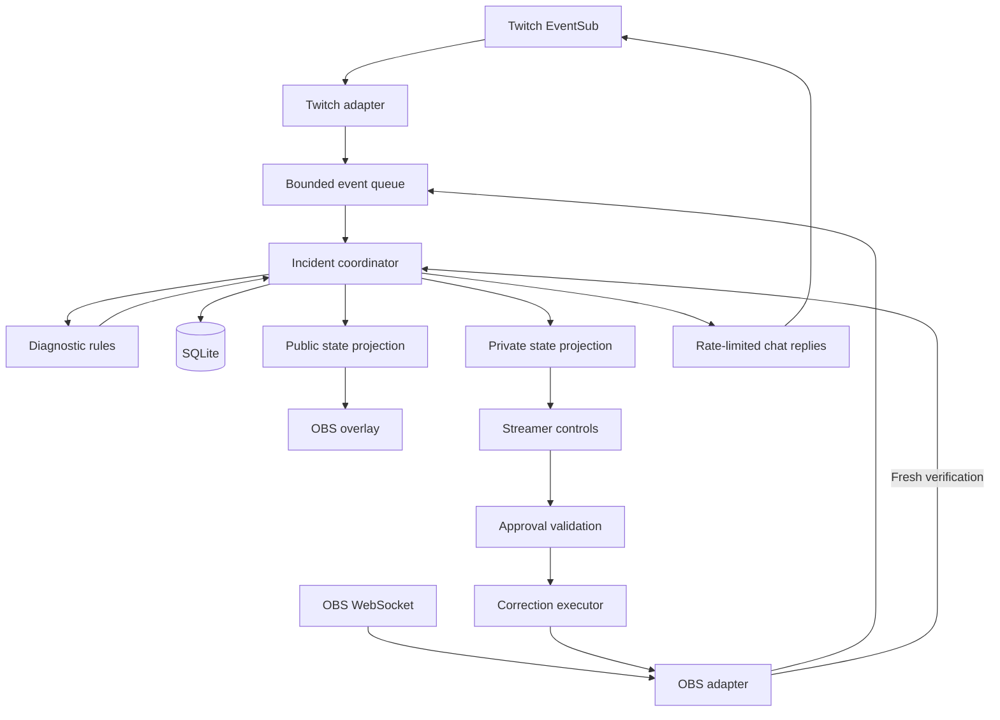

**Go is locked for the backend, and a mixed backend is deferred.** Below is the complete implementation plan for review. No code, project files, installations, or external changes have been made.

The proposed release is:

> **A Windows application that connects Twitch viewer reports with OBS configuration checks, explains the evidence, lets the broadcaster approve a supported correction, and asks viewers to confirm the result.**

I’ll use **LiveCheck** as the working label. **CueMender** remains my preferred name, but the name is not locked.

---

**1. Final proposed technology stack**

Only Go and deferring a mixed backend are already confirmed by you. The rest below is my recommended stack to approve as one coherent implementation.

| Layer | Selected technology | Responsibility |
|---|---|---|
| Backend language | **Go** | All application logic and integrations |
| Application form | **Local executable running in the user’s session** | CLI entry point with background operation |
| Initial platform | **Windows 11 x64** | First supported and tested release target |
| HTTP server | Go standard library `net/http` | Private controls, public overlay, local API |
| Frontend | **HTML, CSS, vanilla JavaScript** | Setup, incident controls, overlay |
| Asset distribution | Go `embed` | Bundle browser files into the executable |
| Browser updates | **Server-Sent Events—SSE** | Push application-state updates to pages |
| Browser actions | HTTP POST requests | Approvals, settings, manual checks |
| OBS integration | **`andreykaipov/goobs`** | OBS WebSocket requests and events |
| Twitch integration | Focused Go adapter using Twitch’s documented APIs | Authentication, subscriptions, chat replies |
| Twitch WebSocket transport | **`coder/websocket`** | EventSub connection transport |
| HTTP client | Go standard library `net/http` | Twitch OAuth and API requests |
| Data validation | Go structs plus explicit validation | Check external events, settings, commands |
| Database | **SQLite through `modernc.org/sqlite`** | Settings, incidents, reports, action history |
| Secret storage | **Windows credential storage through `zalando/go-keyring`** | Twitch tokens and OBS password |
| Logging | Go standard library `log/slog` | Structured, redacted diagnostic logs |
| CLI parsing | Go standard library | Small command surface |
| Configuration | JSON for non-secret configuration | Portable, readable configuration |
| Unit/integration tests | Go `testing`, `httptest`, race detector | Rules, state transitions, protocol behavior |
| Build automation | Go tooling and Windows CI | Reproducible checks and release build |
| Distribution | Windows ZIP containing executable and documentation | No developer runtime required for users |
| Runtime AI | **Optional, deferred until the required MVP works** | Explain established findings or interpret free-form reports |

The candidate dependencies provide the necessary foundations: [goobs](https://github.com/andreykaipov/goobs), [coder/websocket](https://github.com/coder/websocket), [SQLite driver](https://pkg.go.dev/modernc.org/sqlite), and [Go keyring](https://github.com/zalando/go-keyring).

**Dependency versions will be pinned after the initial compatibility check.** I would not invent a “final tested version combination” before compiling it and checking your installed OBS release.

**Why these choices**

- **Vanilla JavaScript:** the interface is small enough that a frontend framework is unnecessary.
- **SSE:** the browser mainly receives state updates; normal HTTP handles its actions. Twitch and OBS still use WebSockets.
- **Focused Twitch adapter:** we need a limited set of OAuth, EventSub, and chat operations. Its lifecycle will be explicitly tested rather than scattered throughout the application.
- **SQLite:** local persistence without another service.
- **OS credential storage:** credentials stay outside ordinary configuration and history files.
- **No runtime AI dependency:** the required diagnostic workflow remains available without a paid model account.

This produces **one backend executable**, with browser assets embedded inside it. The database and settings are created in the user’s application-data directory.

---

**2. Exact MVP scope**

The target MVP includes **three diagnoses and one supported repair action**.

That distinction is deliberate: we can provide useful diagnoses without promising automatic repair for every finding.

| Feature | MVP behavior | Acceptance criterion |
|---|---|---|
| Twitch connection | Authorize one broadcaster and monitor their channel | Actual chat commands arrive in the application |
| OBS connection | Connect to one local OBS instance | Required settings are read correctly |
| Setup | Select microphone, expected streaming audio track, and one visual-source expectation | Configuration survives restart |
| Viewer reports | Accept audio/video issue commands | Reports create or join the correct incident |
| Audio check 1 | Identify that the expected microphone is muted | Finding matches the actual OBS mute state |
| Audio check 2 | Identify that the microphone is absent from the configured stream track | Finding matches actual track assignments |
| Visual check | Identify that a configured source should be visible in a specified scene but is hidden | Finding respects the configured scene expectation |
| Supported repair | Add the microphone to the configured streaming track after approval | Only the intended track assignment changes |
| Private controls | Show evidence, proposed change, approval, dismissal, and status | Broadcaster can operate the complete workflow |
| Public overlay | Show concise incident progress | No private OBS configuration or credentials appear |
| Viewer confirmation | Accept confirmation against an incident ID | Local correction and viewer feedback remain distinguishable |
| Recovery | Reconnect, invalidate stale proposals, preserve history | Disconnection does not cause duplicate repairs |
| Packaging | Run from a clean Windows release folder | User does not need Go or Node.js installed |
| Rehearsal | Demonstrate behavior with labeled fixtures | Simulation is clearly separated from live operation |

**Supported repair**

For the first release:

> Enable the configured streaming track for the selected microphone, preserving its other track assignments.

The application will **not** unmute microphones or reveal hidden visual sources automatically in this release. Those findings receive explanations and manual instructions.

That keeps the main repair focused and avoids accidentally overriding intentional privacy choices.

**What is outside the MVP**

- Raw audio capture or speech analysis.
- Automatic identification of every possible audio problem.
- Frozen-video or black-screen computer vision.
- Windows device repair.
- Native OBS plugins.
- Multiple channels or multiple OBS instances.
- Cloud dashboards and accounts.
- Autonomous AI control.
- Twitch Extensions.
- Desktop application frameworks.
- Automatic operating-system startup.
- Mixed-language backend workers.

These are future directions, not incomplete promises in the submission.

---

**3. The main user journey**

The application should have one clear first-run path.

1. **Launch the executable.**  
   It starts a local server and opens the private setup page.

2. **Connect Twitch.**  
   The broadcaster authorizes their own channel.

3. **Connect OBS.**  
   Enter the local address and WebSocket password.

4. **Declare the expected setup.**  
   Select the microphone and confirm the OBS streaming audio track. Optionally configure the visual-source expectation.

5. **Add the overlay to OBS.**  
   Copy the read-only overlay URL into an OBS browser source.

6. **Start a monitoring session.**  
   The application clearly shows Twitch, OBS, and broadcasting status.

7. **Receive a viewer report.**  
   The incident appears in the private panel and public overlay.

8. **Review the evidence.**  
   The broadcaster sees exactly what was observed and what remains unknown.

9. **Approve a supported correction.**  
   The application rechecks the relevant state, applies the change, and reads it back.

10. **Collect viewer feedback.**  
    The overlay distinguishes “configuration corrected” from “viewer confirmed.”

A manual check should also be available, so the broadcaster can inspect the setup without waiting for a complaint.

---

**4. Twitch interaction design**

The first version uses explicit commands. Free-form language interpretation can come later.

| Command | Meaning |
|---|---|
| `!issue audio` | Report an audio problem |
| `!issue video` | Report a visual problem |
| `!fixed <incident-id>` | Report that the issue appears resolved |
| `!stillbroken <incident-id>` | Report that the issue remains |
| `!streamhelp` | Show a short explanation of the supported commands |

These are proposed command names; they can be renamed without changing the architecture.

**Initial behavior**

- Maintain at most one active incident per category.
- Group repeated reports into that incident.
- Count distinct reporters separately from message volume.
- Apply per-viewer cooldowns and channel-wide reply limits.
- Ignore the application’s own outgoing messages.
- Reject duplicate event deliveries.
- Ignore confirmations for closed or unknown incidents.
- Treat viewer reports as observations, not permissions to modify OBS.

A single report can start an investigation. Multiple reports may increase urgency, but they should not automatically authorize a change.

**Authentication**

Use an installed-application approach with broadcaster user authorization and the scopes needed to read and reply to chat. Twitch documents `user:read:chat` and optional `user:write:chat` for this model. [Installed-chatbot authentication](https://dev.twitch.tv/docs/chat/authenticating/)

The proposed login flow is **Device Code Grant with an appropriately registered public client**, avoiding a distributed client secret. [Twitch OAuth documentation](https://dev.twitch.tv/docs/authentication/getting-tokens-oauth/)

Token handling includes validation at startup and hourly thereafter, as Twitch requires, plus refresh and revocation handling. [Token validation](https://dev.twitch.tv/docs/authentication/validate-tokens/)

---

**5. Diagnostic behavior and evidence**

The application should explain the relationship between an expectation and an observation.

| Check | Required expectation | Evidence | Result |
|---|---|---|---|
| Microphone muted | This is the microphone the broadcaster intends to use | Current mute state | “Your selected microphone is muted.” |
| Audio-track mismatch | This is the confirmed stream audio track | Current microphone track assignments | “Your microphone is not assigned to the configured stream track.” |
| Hidden visual source | This source should be visible in this specific scene | Current scene and scene-item visibility | “The expected source is hidden in this scene.” |

**Important boundaries**

- An active audio meter does not prove that Twitch viewers hear audio.
- A visible source does not prove that its image content is correct.
- A local correction does not prove that all viewers’ playback recovered.
- A user-declared streaming track can become outdated if OBS output settings change.

The private panel therefore displays the configured expectations and lets the broadcaster reconfirm them. Changing expectations invalidates related pending proposals.

Findings should use clear categories such as:

- **Configuration conflict found**
- **No supported conflict found**
- **Insufficient information**
- **OBS unavailable**

I would avoid arbitrary confidence percentages. They would imply more measurement than the MVP actually performs.

---

**6. Application architecture**



All application components shown above run inside **one Go process**.

**Component responsibilities**

| Component | Owns |
|---|---|
| Twitch adapter | Authorization, connection lifecycle, event decoding, subscription management |
| OBS adapter | Connection, required reads, relevant events, supported writes |
| Event normalization | Converting external messages into internal observations |
| Incident coordinator | Incident lifecycle and authoritative application state |
| Diagnostic rules | Pure comparisons between expectations and observations |
| Correction executor | Rechecking, applying, and verifying the supported change |
| Store | Persistence and migrations |
| HTTP layer | Local access controls, commands, browser assets |
| Public projection | Only the information suitable for the broadcast |
| Private projection | Evidence and controls for the broadcaster |
| Rehearsal adapter | Labeled fixture observations without live side effects |

**Concurrency**

Use a bounded event queue and one logical owner of incident state.

Network requests and other potentially slow operations run outside that state owner, returning results tagged with:

- Incident ID.
- Request ID.
- Connection generation.
- Relevant configuration revision.

This prevents a response from an obsolete connection or an earlier configuration from changing the current incident.

High-frequency observations can be summarized in memory. We do not need to persist every meter update.

---

**7. Incident and correction lifecycle**

The normal path is:

```text
Reported
   ↓
Investigating
   ↓
Finding available
   ↓
Awaiting approval
   ↓
Applying correction
   ↓
Local change verified
   ↓
Awaiting viewer confirmation
   ↓
Closed with recorded outcome
```

Other valid outcomes include:

- No supported finding.
- Dismissed by broadcaster.
- Proposal expired.
- Configuration changed.
- Connection interrupted.
- Action outcome uncertain.
- Viewer reports unresolved.

**The correction sequence**

1. Confirm that the private user approved the specific proposal.
2. Check that the proposal has not expired or already executed.
3. Read the microphone’s current track assignments.
4. Confirm that the relevant source and configured track still match.
5. Record the intended change.
6. Apply the narrow update.
7. Read back the track assignments.
8. Record what was actually observed.
9. Publish the appropriate status.

If the write times out, the application must not immediately send it again. It first attempts to determine whether the change took effect.

**Restart behavior**

- Historical incidents remain visible.
- Pending approvals become invalid.
- Interrupted actions are marked for reconciliation.
- No stored action executes automatically after restart.
- Fresh OBS state is collected before proposing another correction.

**Undo**

Undo is a desirable enhancement, but not required for the core release. If included, it must verify that the relevant state still matches what the application last wrote. It must not overwrite a subsequent manual change.

---

**8. Local storage, credentials, and interface boundaries**

**SQLite contents**

| Record | Stored information |
|---|---|
| Settings | Non-secret expectations, selected source identifiers, preferences |
| Incidents | Category, status, timestamps, outcome |
| Reports | Minimal command metadata and reporter identifier needed for deduplication |
| Findings | Evidence relevant to the diagnosis |
| Actions | Proposed change, prior state, execution and verification outcomes |
| Delivery records | Bounded deduplication metadata |

Do not archive the entire Twitch chat. Store only information needed for the feature, with bounded history and a clear way to clear it.

**Credentials**

- Twitch tokens and OBS password go into OS credential storage.
- Credentials do not appear in SQLite incident records, overlays, or logs.
- If credential storage is unavailable, offer an explicit session-only mode.
- Do not silently fall back to saving passwords in plain configuration files.

**Local access**

- Bind the server to loopback by default.
- Require an authenticated local session for private controls.
- Validate request origins and hosts.
- Protect state-changing requests against cross-site requests.
- Give the overlay only read access to a sanitized state projection.
- Render viewer-controlled content as text.

The public overlay should normally show category, progress, and outcome—not raw usernames, source names, or detailed OBS configuration.

---

**9. Interface scope**

There are three small surfaces.

| Surface | Required content |
|---|---|
| **Setup page** | Twitch connection, OBS connection, selected expectations, overlay URL, readiness status |
| **Private incident panel** | Evidence, diagnosis, proposed correction, approval/dismissal, connection state, recent history |
| **Public overlay** | Compact status such as “Audio issue reported,” “Checking,” “Configuration corrected,” and “Awaiting confirmation” |

The overlay should be quiet when nothing is happening. It should not occupy a large part of the stream continuously.

A clear disconnected or stale-data indication matters more than decorative animation.

Before implementing the interface, we should settle its visual direction and review the main states together. The UI should be tested for keyboard use, readable contrast, and text that remains legible in an actual broadcast.

---

**10. Proposed project organization**

This is a conceptual structure, not files already created:

```text
cmd/
  app/                 CLI entry point

internal/
  app/                 Startup, shutdown, dependency wiring
  twitch/              OAuth, EventSub, chat API
  obs/                 OBS adapter
  diagnostics/         Rules and findings
  incidents/           State transitions and report grouping
  actions/             Approval and correction execution
  store/               SQLite and migrations
  secrets/             OS credential storage
  httpui/              Private/public HTTP routes
  rehearsal/           Labeled fixture source

web/
  control/             Private interface
  overlay/             Public display

testdata/
  events/
  obs/
  scenarios/

docs/
  setup
  architecture
  testing
  limitations

release/
  Packaging definitions and instructions
```

The structure separates responsibilities without turning each directory into a service.

No worker framework is needed. A future specialist component can connect through the observation/finding boundaries.

---

**11. Implementation and execution phases**

The phases below are sequential by default. Tests and documentation accompany the relevant feature rather than being postponed entirely to the end.

**Phase 0 — Review and scope approval**

| Subphase | Tasks and subtasks | Completion condition |
|---|---|---|
| 0.1 Product decisions | Review the three checks, single repair, commands, and platform | Product behavior agreed |
| 0.2 Naming | Choose the public name; use a temporary internal label until then | Naming decision recorded |
| 0.3 Stack review | Approve Go, vanilla browser interface, SQLite, and dependency approach | Stack agreed |
| 0.4 Submission scope | Confirm runtime AI is optional and future features are excluded | Claims match intended release |

**Gate:** implementation begins only after you authorize building.

**Phase 1 — Environment and compatibility verification**

| Subphase | Tasks and subtasks | Completion condition |
|---|---|---|
| 1.1 Workspace inspection | Read repository instructions; inspect existing files and tools; preserve existing work | Environment understood |
| 1.2 Toolchain | Select supported Go toolchain; check build prerequisites | Basic Windows build works |
| 1.3 OBS verification | Record installed version; inspect WebSocket configuration; identify a dedicated test setup | Supported OBS target documented |
| 1.4 Dependency probe | Verify goobs reads mute state, track assignments, and scene visibility correctly | Required data confirmed |
| 1.5 Twitch setup | Register/configure app; verify user authorization and own-channel subscription | Real chat event received |
| 1.6 Version pinning | Pin the successful dependency versions; record licenses | Reproducible dependency baseline |

**Gate:** both real integrations work before substantial interface development.

This phase is where compatibility uncertainty should be discovered—not during demo recording.

**Phase 2 — Application foundation**

| Subphase | Tasks and subtasks | Completion condition |
|---|---|---|
| 2.1 Application lifecycle | Startup, shutdown, cancellation, single-instance behavior | Clean process lifecycle |
| 2.2 Configuration | Load defaults; validate settings; select application-data location | Invalid configuration produces useful errors |
| 2.3 Persistence | Create schema and migrations; add store tests | Settings and history persist correctly |
| 2.4 Credentials | Implement OS credential storage and session-only behavior | Secrets stay out of ordinary files |
| 2.5 HTTP shell | Serve embedded assets; establish private/public routes | Minimal browser interface opens |
| 2.6 Internal contracts | Define observations, findings, incidents, and actions | Components have clear boundaries |

**Gate:** the executable starts, serves its interface, persists basic state, and shuts down cleanly.

**Phase 3 — Twitch integration**

| Subphase | Tasks and subtasks | Completion condition |
|---|---|---|
| 3.1 Authorization | Device login, scope validation, identity validation, token storage | Correct broadcaster account connected |
| 3.2 Token lifecycle | Startup/hourly validation, refresh, logout, revocation | Invalid sessions stop being used |
| 3.3 EventSub lifecycle | Welcome, subscription, keepalive, reconnect, revocation | Connection status is accurate |
| 3.4 Command intake | Parse supported commands; enforce cooldowns; ignore self-messages | Commands produce normalized events |
| 3.5 Deduplication | Track delivery IDs; reject old-connection events | Duplicate events do not repeat effects |
| 3.6 Replies | Bounded outgoing queue; check API responses; avoid spam | Concise replies reach chat |

An ordinary lost EventSub connection has different recovery behavior from a server-directed reconnect, and missed events are not replayed automatically. The adapter must reflect those distinctions. [EventSub WebSocket documentation](https://dev.twitch.tv/docs/eventsub/handling-websocket-events/)

**Gate:** real Twitch commands reach the application and receive controlled responses.

**Phase 4 — OBS integration and expectations**

| Subphase | Tasks and subtasks | Completion condition |
|---|---|---|
| 4.1 Connection | Authenticate; show disconnected/error states; reconnect | OBS lifecycle behaves predictably |
| 4.2 Discovery | List relevant inputs, scenes, and scene items | Broadcaster can choose actual targets |
| 4.3 Expectations | Store microphone, confirmed stream track, and scene-specific visual expectation | Setup is explicit and persistent |
| 4.4 Observations | Read required state; subscribe to relevant changes | Current observations available |
| 4.5 Freshness | Timestamp observations; invalidate them after disconnect/configuration changes | Stale data is not treated as current |

**Gate:** the private panel can accurately display the selected OBS configuration.

**Phase 5 — Diagnostics and incidents**

| Subphase | Tasks and subtasks | Completion condition |
|---|---|---|
| 5.1 Rules | Implement muted-microphone, track-mismatch, and hidden-source checks | Fixture tests cover correct and incorrect configurations |
| 5.2 Evidence | Produce concise evidence and manual instructions | Every finding is traceable to observations |
| 5.3 Grouping | Merge reports by category; track distinct reporters | Repeated complaints produce one coherent incident |
| 5.4 Lifecycle | Implement investigation, proposal, dismissal, unresolved and closed states | Transitions are explicit |
| 5.5 Feedback | Handle incident-specific fixed/still-broken reports | Viewer feedback does not masquerade as local measurement |
| 5.6 History | Persist relevant incident events | Restart preserves understandable history |

**Gate:** a real chat report produces the correct diagnosis from real OBS state.

**Phase 6 — Supported correction**

| Subphase | Tasks and subtasks | Completion condition |
|---|---|---|
| 6.1 Proposal | Describe the precise track change and evidence | Broadcaster understands what approval permits |
| 6.2 Approval | Bind to incident, configuration revision, and expiry | Old or duplicate approval is rejected |
| 6.3 Execution | Read current state; preserve unrelated tracks; apply narrow update | Only the intended setting changes |
| 6.4 Verification | Read back; distinguish success, failure, and unknown outcome | No false success announcement |
| 6.5 Recovery | Reconcile timeout/restart; prevent blind replay | Interrupted operations remain controlled |

**Gate:** the complete live flow works: report → diagnosis → approval → correction → read-back → viewer feedback.

This is the most important milestone.

**Phase 7 — Interface and public experience**

| Subphase | Tasks and subtasks | Completion condition |
|---|---|---|
| 7.1 Visual direction | Review layout, typography, colors, and state vocabulary | Interface direction settled |
| 7.2 Setup | Finish connection and expectation controls | New user can configure without editing source |
| 7.3 Private panel | Evidence, approval, dismissal, manual check, history | Complete workflow is operable |
| 7.4 Overlay | Compact states, idle behavior, readable progress | Clear when viewed through Twitch |
| 7.5 Accessibility | Keyboard use, focus behavior, contrast, labels | Main tasks work without mouse-only interaction |
| 7.6 Rehearsal | Add labeled fixture scenarios; disable live side effects | Demo mode cannot be confused with live mode |

**Gate:** the application is understandable to someone who has not read the code.

**Phase 8 — Reliability and meaningful verification**

| Subphase | Tasks and subtasks | Completion condition |
|---|---|---|
| 8.1 State tests | Duplicate reports, late confirmations, expired proposals | Expected outcomes repeat reliably |
| 8.2 Connection tests | OBS disconnect, Twitch disconnect, superseded sockets | Stale observations cannot trigger action |
| 8.3 Action tests | State changed before approval; write timeout; double approval | No unintended repeated correction |
| 8.4 Persistence tests | Restart during pending approval/action; database reopen | Recovery is explicit |
| 8.5 Access tests | Public routes cannot execute actions; cross-origin writes rejected | Public/private boundary holds |
| 8.6 Live acceptance | Real Twitch reports and real OBS correction | End-to-end evidence recorded |
| 8.7 Resource check | Observe idle and active CPU/memory while streaming | No obvious interference with OBS |

Use the race detector and relevant automated checks where supported, then test the release build itself. Automated fakes and live verification should be reported separately.

**Gate:** all required acceptance criteria pass, and known limitations are documented.

**Phase 9 — Packaging and documentation**

| Subphase | Tasks and subtasks | Completion condition |
|---|---|---|
| 9.1 Release build | Embed assets; add version information; produce Windows ZIP | Packaged executable runs |
| 9.2 Fresh setup test | Extract into a new location; follow documentation | No hidden development-environment dependency |
| 9.3 Setup guide | Twitch registration/login, OBS configuration, overlay setup | Reproducible installation |
| 9.4 User guide | Commands, incidents, supported correction, limitations | Behavior is clear |
| 9.5 Technical notes | Architecture, dependencies, test evidence, Codex use | Reviewers can assess implementation |
| 9.6 Repository review | Remove secrets; include source/assets/licenses; verify links | Repository is submission-ready |

**Gate:** another person can install and exercise the documented workflow.

**Phase 10 — Demonstration and submission**

| Subphase | Tasks and subtasks | Completion condition |
|---|---|---|
| 10.1 Demo preparation | Dedicated scene setup; synthetic material; planned fault | Repeatable demonstration |
| 10.2 Live recording | Capture actual Twitch interaction and correction | Real integration shown |
| 10.3 Codex evidence | Capture genuine build/debugging activity; record main session ID | Tool use accurately documented |
| 10.4 Editing | Keep video under three minutes; explain one edge case | Clear, concise demonstration |
| 10.5 Submission text | Describe implemented features, limitations, stack, and Codex contributions | Claims match evidence |
| 10.6 Final review | Check video visibility, repository access, setup instructions, links | Concrete submission ready for review |
| 10.7 Submit and freeze | Submit when authorized; verify submitted status; preserve submitted artifacts | Entry is actually submitted |

The organizer accepts unlisted YouTube videos, requires real running footage, and warns that a saved draft is not a submission. The latest update also instructs entrants to leave submitted artifacts unchanged after the deadline until winners are announced. [Organizer update](https://twitchcon-codex.devpost.com/updates/47341-final-weekend-make-your-project-come-alive)

---

**12. Execution priorities and scope control**

The implementation order should be:

> **Real connections → one complete diagnostic-and-repair flow → remaining checks → polished interface → reliability → packaging → submission.**

This matters more than completing every architectural layer before trying the product.

| Priority | Work |
|---|---|
| **Required** | Real integrations, three checks, one repair, reports/confirmation, private controls, overlay, recovery, packaging |
| **Optional after required work passes** | Undo, richer history, free-form report interpretation, AI explanations |
| **Deferred** | Raw audio analysis, Windows helpers, native plugins, mixed backend, multi-channel hosting |

The first working route-mismatch demonstration should happen early. It will reveal whether the central product is useful and whether the actual integrations behave as expected.

No optional feature should consume the time reserved for live verification, fresh installation, recording, and submission.

If the remaining time cannot support the required release, we should explicitly review a reduced scope rather than quietly presenting unfinished behavior as complete.

---

**13. Definition of done**

I would consider the MVP complete only when:

- It runs from its packaged Windows distribution.
- Twitch and OBS setup work using the documented instructions.
- All three checks match the supported test scenarios.
- A real viewer report starts the intended investigation.
- The supported repair requires broadcaster approval.
- The repair preserves unrelated settings.
- Read-back determines the local outcome.
- Viewer confirmation remains a separate status.
- Duplicate and stale events do not repeat corrections.
- Disconnects and restarts produce understandable behavior.
- Public output does not expose private configuration.
- Rehearsal and live operation are clearly distinguished.
- The repository contains what a reviewer needs to run it.
- The video demonstrates actual Twitch functionality and actual Codex use.

**The remaining review decisions are small:** the public name, approval of this single-repair MVP boundary, and whether vanilla JavaScript is acceptable for the browser interface. My defaults are **CueMender**, the scope described above, and **vanilla JavaScript**.

Once you approve the plan and authorize implementation, the first action will be environment and compatibility verification—not a large scaffold or a mixed-backend experiment.