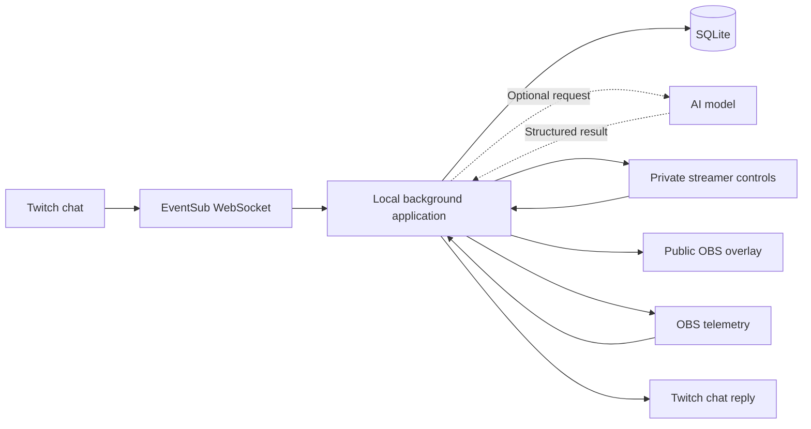

**The rules strengthen the case for LiveCheck and ActionGate, and they make me more cautious about recommending a general-purpose CLI with only a small Twitch connection.**

A CLI or background service can absolutely be the main application. What matters is that it produces a useful, interactive experience for a streamer and their community—and that judges can understand and see it working quickly.

My revised ranking is:

| Rank | Project | Recommendation |
|---|---|---|
| **1** | **LiveCheck — community-assisted stream diagnostics** | **Best balance of real usefulness, Twitch relevance, technical depth, and achievable scope.** |
| **2** | **ActionGate — controlled audience co-production** | **Best for a visibly interactive demo and a broader future in AI automation.** |
| **3** | **AccessLens — viewer-requested visual explanations** | **Best if you want AI to be essential and accessibility to be the main impact.** |
| **4** | **ShareSafe — an interactive, sanitized teaching terminal** | **Best CLI-centered product, but needs careful differentiation and a convincing community workflow.** |
| 5 | LinkBrief | Worth considering as a moderator tool. |
| 6 | SpendBrake | Useful infrastructure, but harder to make compelling within three minutes. |
| 7 | OriginReceipt | Technically interesting; comparatively difficult to communicate and validate. |
| 8 | InstallScope | Better suited to a developer/security hackathon. |

These rankings are my assessment of the **specific versions described below**, not a prediction of the judges’ decisions.

**What your screenshot means for the project**

Your screenshot establishes several concrete requirements. Here is how I would turn them into design decisions:

| Requirement in your screenshot | Practical implication |
|---|---|
| Build for streamers and their community | Start with an actual live-streaming workflow. Broader business applications can be the expansion story. |
| Interactive experience connected to Twitch | Show an action and a response: a report, request, approval, explanation, or change visible on stream. |
| Successfully installs and runs consistently | A clean installation and dependable recovery matter more than adding another speculative feature. |
| Runs on its declared platform | We can initially support **Windows + OBS**, provided we clearly state and test that combination. |
| Newly created during the submission period | Create a new project and original implementation. Use existing libraries as dependencies, with attribution and appropriate licenses. |
| Code, assets, and running instructions available | Include sample configuration, original demo assets, dependency versions, and setup instructions. |
| Explain and show how Codex was used | Preserve actual build footage and describe specific contributions, debugging, and verification. |
| Demonstrate it working on Twitch | Record real Twitch interaction and resulting behavior—not just a local mock. |
| Video under three minutes | Choose a project whose main value can be demonstrated in roughly 60–90 seconds. |

**Chat commands are a recommendation, not an additional rule.** The screenshot explicitly allows several connection methods, including overlays. However, a meaningful chat interaction often makes the project’s benefit much easier to demonstrate.

The judging criteria add another consideration: innovation, streamer/community impact, technical implementation—including Codex—and design are equally weighted. Design explicitly includes ease of use and watchability. A technically sophisticated background service therefore needs an understandable public-facing result. [Judging criteria](https://twitchcon-codex.devpost.com/)

The organizer’s latest update also clarifies that **unlisted YouTube videos are acceptable; private videos are not**, and that the video needs actual running footage. [Submission update](https://twitchcon-codex.devpost.com/updates/47341-final-weekend-make-your-project-come-alive)

---

**The common architecture I recommend**

For the leading ideas, I would begin with **one local application, one small database where needed, and a tiny browser interface**.



These boxes represent responsibilities, **not separate microservices**.

The local process would:

- Connect outward to Twitch.
- Connect locally to OBS when required.
- Process incoming events.
- Serve a read-only public overlay.
- Serve separate private controls.
- Persist only the state needed for recovery.

Twitch recommends EventSub and its API for modern chat integrations. Its documentation specifically identifies WebSockets as suitable for installed applications, which avoids needing a public webhook server for this architecture. [Chat documentation](https://dev.twitch.tv/docs/chat/), [Installed-chatbot authentication](https://dev.twitch.tv/docs/chat/authenticating/)

One distinction matters: an **OBS browser source** is a web page OBS renders into the broadcast. It is different from a Twitch Extension. These projects can use the former without implementing the latter.

For your own channel, the initial integration can act through your broadcaster account with the required user authorization. The documented installed-chatbot scopes begin with `user:read:chat`, adding `user:write:chat` for replies. Extra features would need their own permissions. [Authentication requirements](https://dev.twitch.tv/docs/chat/authenticating/)

---

**1. LiveCheck — my recommended project**

**Pitch:** “Your community reports a stream problem; LiveCheck checks the evidence, explains the likely cause, and helps you fix it without interrupting the show.”

This is stronger than a passive stream-health dashboard because it connects the audience’s experience to the broadcaster’s actual configuration.

**How it would function**

Imagine a technical tutorial stream:

1. A viewer sends `!issue audio`.
2. LiveCheck acknowledges the report and groups subsequent reports into the same incident.
3. It examines the configured microphone, mute state, monitoring mode, and track assignments.
4. It compares those observations with the broadcaster’s declared setup.
5. The private panel shows a diagnosis and its evidence.
6. The broadcaster approves a specific change.
7. LiveCheck applies it, reads back the relevant state, and asks viewers to confirm whether the problem is resolved.

The public overlay could show:

> Audio issue reported → configuration checked → correction applied → awaiting viewer confirmation

It should never display a definitive “everyone can hear you” simply because a local setting changed.

**The actual MVP**

I would implement three narrowly defined checks:

| Check | Evidence | Initial behavior |
|---|---|---|
| Expected microphone is muted | Selected microphone and its mute state | Explain; offer unmute during an explicit audio check. |
| Microphone is absent from the configured stream track | Selected output track and microphone track assignments | Explain the mismatch; offer a targeted correction. |
| Expected visual source is hidden in the current scene | Broadcaster-configured expectation and scene-item visibility | Explain; offer to show the source. |

The broadcaster should identify the expected microphone and streaming track during setup. We should not assume every OBS installation uses the same output configuration.

OBS exposes the relevant track, monitor, scene, and output controls through its WebSocket protocol. Its volume events are telemetry, not raw audio samples or proof of remote playback. [OBS protocol](https://github.com/obsproject/obs-websocket/blob/master/docs/generated/protocol.md)

**Internal architecture**

```text
Viewer reports + OBS observations
                 ↓
        Incident correlator
                 ↓
       Diagnostic rules
                 ↓
 Evidence + proposed correction
                 ↓
       Streamer approval
                 ↓
 Apply → read back → viewer confirmation
```

Each incident would have a small lifecycle:

```text
Reported → Investigating → Action proposed → Applied → Confirmed
```

“Unresolved” and “insufficient evidence” must also be valid outcomes.

**Recommended stack**

| Component | Recommendation | Why |
|---|---|---|
| Main application | **TypeScript + Node.js** | One language for Twitch, OBS, state, and browser controls. |
| Twitch integration | **Twurple auth/API/EventSub packages** | Existing abstractions for authentication, API calls, and events. |
| OBS integration | **obs-websocket-js** | Typed access to OBS requests and events. |
| Diagnostic engine | Plain TypeScript rules | Easy to inspect and test against known configurations. |
| Persistence | SQLite | Store incidents, deduplication IDs, and correction history. |
| Interface | Small HTML/CSS/TypeScript pages | Enough for setup, approval, and a clear overlay. |
| Optional AI | Structured-output text model | Group free-form complaints and explain established findings. |
| Verification | Unit tests plus a real OBS scene collection | Validate both diagnosis logic and the actual integration. |

[Twurple](https://github.com/twurple/twurple) and [obs-websocket-js](https://github.com/obs-websocket-community-projects/obs-websocket-js) provide the integration foundations; the diagnosis and interaction workflow would be your original work.

**Alternatives**

- **Python:** Good if you want to add signal processing later. Use an asynchronous OBS client, Pydantic, SQLite, and a small local HTTP server.
- **Go:** Reasonable for a compact executable, especially if you already know it. More integration work may be needed.
- **Rust:** Technically suitable, but I would choose it only if it materially improves your delivery speed or fits your proposed stack.
- **No runtime AI:** A valid first version. Fixed commands and evidence-based explanations can deliver the core value reliably.

**What should make it distinctive**

The contribution is the complete sequence:

> Community report → configuration evidence → understandable correction → verified state change → community feedback.

A general AI assistant that suggests “restart OBS” would be much less compelling.

**What judges would see**

A real viewer reports missing audio. The tool identifies a planted routing mismatch, explains it, and applies the approved correction. The viewer confirms the improvement.

This makes usefulness, interaction, implementation, and design visible in one sequence.

**Limits and scope**

Keep automatic changes narrow. Recheck state before applying a correction, and offer undo only when it would not overwrite a newer manual change.

Defer raw audio capture, operating-system troubleshooting, frozen-video detection, and universal “AI repair.”

**Beyond Twitch:** webinars, remote classes, live product demos, and small production teams.

---

**2. ActionGate — strongest audience-interaction alternative**

**Pitch:** “Let chat help produce the stream while the broadcaster stays in control of what can happen.”

The product should feel like a collaborative stream tool. Its permission engine is the technical foundation.

**How it would function**

A viewer writes:

> “Show the close-up scene for ten seconds.”

The system:

1. Receives the message with Twitch-provided sender identity.
2. Converts it into a structured proposal.
3. Checks whether that viewer can request that action.
4. Checks the target scene, duration, cooldown, and current state.
5. Requests broadcaster approval if the policy requires it.
6. Executes the permitted action.
7. Displays the result on stream.

The model never gets general access to OBS or the shell. It can only propose actions from a small catalog.

**The actual MVP**

Three capabilities are enough:

- Switch temporarily to one of two approved scenes.
- Display a viewer’s proposed title after approval.
- Start a bounded on-screen timer.

Three permission levels are also enough:

- Viewer: propose.
- Moderator: approve selected low-impact actions, if enabled.
- Broadcaster: configure and approve all supported actions.

Broadcaster identity and permissions must come from authenticated application state and trusted event metadata—not text such as “I am the moderator.”

**Internal architecture**

```text
Chat message
     ↓
Command parser / AI interpreter
     ↓
Typed proposal
     ↓
Policy checks
     ↓
Reject, queue for approval, or allow
     ↓
Action executor
     ↓
OBS state + public action receipt
```

An example internal proposal could contain:

```json
{
  "action": "show_scene_temporarily",
  "scene": "close_up",
  "duration_seconds": 10
}
```

The server adds the actor, event ID, expiry, and approval state. Those fields are not accepted as claims from the model.

**Recommended stack**

| Component | Recommendation | Why |
|---|---|---|
| Main application | **TypeScript + Node.js** | Strong fit for typed event-driven workflows. |
| Input interpretation | Fixed commands first; optional text model | Keeps the product usable when inference fails. |
| Validation | **Zod** | Validate action types, arguments, and ranges. |
| Policy engine | Small explicit TypeScript module | Three capabilities do not need a general policy platform. |
| State | SQLite | Persist proposals, approvals, expiry, and execution outcomes. |
| OBS adapter | obs-websocket-js | Executes the supported operations. |
| Twitch adapter | Twurple/EventSub | Receives requests and sends concise responses. |
| Interface | Private approval queue + public overlay | Separates privileged controls from audience feedback. |

**Alternatives**

- **Python + Pydantic:** Equivalent approach if you prefer Python.
- **Rust:** Attractive for the permission engine, but a separate Rust component is unnecessary unless your stack has a concrete reason for it.
- **MCP interface:** Useful later for other agent clients. It should not be required for the Twitch MVP.
- **General policy engine:** Consider later if permissions become complex. Initially, explicit code is easier to review.

**Where the technical depth sits**

- Approval applies to the exact action and arguments.
- Expired approvals cannot execute.
- Duplicate events cannot repeat an action unintentionally.
- Changes in OBS state can invalidate a queued proposal.
- A temporary scene switch should not automatically undo a newer manual scene change.
- After an uncertain execution outcome, the system checks state rather than blindly retrying.

For example, prefer “set visibility to true” over “toggle visibility.” Repeating the former is easier to reason about.

**Differentiation**

Existing MCP gateways already handle interception and security features. Your contribution is a usable live collaboration workflow with session-specific roles, exact approvals, and observable effects. [Existing MCP gateway](https://github.com/lasso-security/mcp-gateway)

**What judges would see**

One audience request succeeds, another requires approval, and an unsupported request is rejected with a clear explanation. The stream changes immediately when the approved action runs.

**Beyond Twitch:** controlled business assistants, internal automation, and approval-based agent workflows.

**My assessment:** This may produce the most entertaining demo of the shortlist. Its main weakness is that the permission model must be genuinely implemented; a superficial approval button would not provide much technical differentiation.

---

**3. AccessLens — strongest AI-centered choice**

**Pitch:** “Ask about the part of a live stream you cannot see clearly, and receive a concise explanation tied to that moment.”

The initial audience could include blind and low-vision viewers, people watching on small screens, and learners struggling to follow a visual demonstration.

**How it would function**

1. The streamer enables AccessLens for a specific OBS source.
2. A viewer sends `!read` or `!describe`.
3. The application captures that approved source.
4. It attaches a timestamp and processes the frame.
5. A vision model returns a constrained answer.
6. The answer appears as a chat reply and an optional readable overlay.
7. The viewer can request clarification.

The first version should explicitly describe **the frame captured when the request reaches the application**. Twitch playback latency means that may differ from the exact frame the viewer was watching.

**The actual MVP**

Choose **software tutorials or slide presentations**, with:

- `!read`: transcribe visible text.
- `!describe`: explain the current diagram or visual arrangement.
- One approved source.
- One outstanding request at a time.
- Cooldowns and duplicate-request grouping.
- A timestamp and an “unable to read reliably” outcome.

Avoid fast gameplay and continuous narration initially.

**Internal architecture**

```text
Viewer request
      ↓
Rate limit + request queue
      ↓
Approved OBS-source screenshot
      ↓
Resize / optional crop / optional OCR
      ↓
Vision model
      ↓
Schema validation + freshness checks
      ↓
Chat response + readable presentation
```

**Recommended stack**

For the narrow screenshot-and-answer version, I would actually prefer **TypeScript + Node.js** over introducing Python immediately.

| Component | Recommendation | Why |
|---|---|---|
| Main application | TypeScript + Node.js | Keeps Twitch and OBS integration simple. |
| Screenshot capture | obs-websocket-js | Uses the broadcaster-approved source. |
| Image preparation | A small image-processing library | Resize/crop before inference. |
| AI | Vision-capable model with structured output | Reading and visual explanation are central capabilities. |
| Queue | In-process bounded queue | Sufficient for a single stream. |
| State | Memory initially; SQLite for request metadata if needed | Raw screenshot storage is unnecessary for the core feature. |
| Output | Twitch replies and accessible HTML | Viewers should not need to visually read an overlay to benefit. |
| Optional speech | Viewer-controlled speech in a companion page | Avoids forcing narration into everyone’s audio. |

**Alternatives**

- **Python + Pillow/OpenCV + Pydantic:** Better if you decide to invest in OCR, visual comparisons, or local model experiments.
- **Hosted vision model:** Simplest hardware requirements, but introduces network latency and usage costs.
- **Local vision model:** More local control, but must be benchmarked alongside OBS; it may compete with stream encoding.
- **OCR followed by a text model:** Useful for text-heavy screens, but weaker for diagrams and visual relationships.

I would select the model by testing your actual demo images, not by choosing whichever model has the newest release date.

**Differentiation**

Live audio-description projects already exist, including [Murmure](https://github.com/phrnl0xyz/murmure). AccessLens should focus on viewer-directed questions, approved broadcast sources, and timestamps rather than claiming novelty for “AI describes video.”

The ViDscribe research supports investigating customized descriptions and question answering, while also showing why user preferences matter. [Research](https://arxiv.org/abs/2603.14662)

**What judges would see**

A viewer asks about an unread chart or small error message and gets a useful answer. A deliberately unclear frame produces an honest inability to answer.

**Validation**

Use a small set of original slides, diagrams, and error screens with known answers. Measure correctness, unsupported details, response delay, and accessibility of the controls.

**Beyond Twitch:** online teaching, onboarding, webinars, and remote support.

**My assessment:** Strong potential impact and visible AI value, but the highest uncertainty in output quality among the top three.

---

**4. ShareSafe — strongest CLI-centered choice**

**Pitch:** “Teach and demonstrate from your terminal while broadcasting a separate, sanitized view that viewers can ask questions about.”

I would revise the original proposal in two ways:

1. Make the public output a first-class product surface.
2. Give viewers a useful interaction with that output.

**How it would function**

The broadcaster launches a supported command through ShareSafe. Its output is processed before it reaches the public renderer.

Public lines receive stable identifiers. A viewer can ask:

```text
!explain 42
```

The explanation feature receives only the sanitized public text around line 42.

That creates a natural education workflow while retaining the original privacy purpose.

**The actual MVP**

- Line-oriented command output.
- User-specified sensitive values and selected credential patterns.
- Separate public renderer.
- Supported formatting only.
- An optional `!explain` command using sanitized output.
- No arbitrary audience command execution.

**Internal architecture**

```text
Command stdout/stderr
        ↓
Streaming decoder + line assembly
        ↓
Supported formatting normalization
        ↓
Sensitive-value detection
        ↓
Sanitized public records
        ├── OBS browser view
        └── Viewer explanation requests
```

Do not send raw output to the public browser and attempt to hide it afterward.

For the first version, complete-line buffering is defensible. An incomplete or excessively long line can remain withheld rather than being emitted before the checks finish.

**Recommended stack**

| Component | Recommendation | Why |
|---|---|---|
| Main application | TypeScript + Node.js | Good process, stream, and web integration. |
| Process launch | Node child processes | Simpler than emulating an interactive terminal. |
| Redaction | Explicit-value matching plus bounded pattern detectors | Inspectable behavior for supported content. |
| Public renderer | Small escaped-text HTML renderer | Reduces terminal-control complexity. |
| Delivery | Local WebSocket | Publishes only sanitized records. |
| Twitch interaction | EventSub commands | Supports line-specific questions. |
| Optional AI | Text model operating only on sanitized records | Explains output without receiving the original secret-bearing stream. |

**Alternatives**

- **Python:** Straightforward for piping logs and processing lines.
- **Rust:** Good if the redaction stream itself is the main engineering focus.
- **node-pty:** Add only when interactive programs are required. It supports Windows through ConPTY, but terminal emulation adds complexity. [node-pty](https://github.com/microsoft/node-pty)
- **Existing redaction library:** Potentially useful after reviewing its patterns, limitations, and license. Do not inherit its advertised guarantees without testing them.

**Differentiation**

Warp already provides terminal secret redaction. The distinctive product would be a separate broadcast output with controlled publication, explicit sharing policies, and viewer interaction. [Warp’s redaction feature](https://www.warp.dev/blog/dont-accidentally-leak-secrets-from-your-terminal)

**What judges would see**

A program emits synthetic sensitive values across awkward output chunks. The broadcast shows sanitized text. A viewer requests an explanation of a public line and receives it.

**Validation**

Test split UTF-8 characters, split credentials, incomplete lines, carriage returns, supported escape sequences, false positives, and model explanations containing only public information.

**Beyond Twitch:** technical training, conference demos, customer support, and recorded tutorials.

**My assessment:** A credible CLI project, but its boundaries must be honest. It does not protect other windows, speech, arbitrary sensitive information, or raw screen capture.

---

**How I would revise the other four ideas**

They remain options, but I would give them less attention for this event.

| Idea | Twitch-specific version | Compact architecture and stack | Why it ranks lower |
|---|---|---|---|
| **LinkBrief** | Moderator-requested explanations of suspicious links and collaboration offers | EventSub → bounded URL inspection → evidence extraction → moderator report. Python, HTTPX, Pydantic, SQLite, optional text model. TypeScript is a suitable alternative. | Useful, but the demo must avoid unsupported fraud claims. Safe URL fetching adds work. |
| **SpendBrake** | A governor for an audience-triggered AI feature, showing batching and fallback when demand increases | Twitch event IDs → reservation/deduplication → one provider adapter → usage reconciliation. TypeScript or Go, SQLite. | Requires another feature to make its benefit visible, and existing gateways already cover much of the general problem. |
| **OriginReceipt** | Viewers inspect provenance for original artwork created live | Export watcher → C2PA signing → original-asset storage → verification response. Rust plus C2PA SDK; Node wrapper alternative. | Signing, signer trust, and truth are easy to confuse. The demo needs more explanation. |
| **InstallScope** | Live review of prepared package updates during coding streams | Artifact download → static version comparison → evidence report → chat discussion. TypeScript, archive parser, JavaScript parser, optional model. | The main value is developer tooling; Twitch can feel incidental. |

For SpendBrake, I would study [Bifrost](https://github.com/maximhq/bifrost) before rebuilding gateway functionality. For OriginReceipt, use the existing [C2PA tooling](https://github.com/contentauth/c2pa-rs) and distinguish integrity verification from whether a depicted event is true.

I would not expand all eight into prototypes. The best use of the remaining time is to select one and prove its main interaction.

---

**How the leading projects map to the judging criteria**

| Criterion | LiveCheck | ActionGate | AccessLens | ShareSafe |
|---|---|---|---|---|
| **Innovation** | Combining audience reports with configuration evidence and repair feedback | Session permissions and exact approvals applied to audience co-production | Viewer-directed, timestamped visual assistance | Separate publication boundary plus interactive teaching |
| **Potential impact** | Fewer disrupted streams and less creator distraction | More audience participation with predictable control | Better access to visually dependent content | Safer technical demonstrations |
| **Technical implementation** | State correlation, diagnosis, rechecking, recovery | Authorization, deduplication, expiry, state-aware execution | Frame selection, inference, freshness, abstention | Stream parsing, buffering, redaction, output isolation |
| **Design** | Clear incident progress and concise correction controls | Immediate, understandable audience effects | Readable, accessible answers with minimal disruption | Clean public terminal and simple viewer questions |
| **Main weakness** | Becoming a generic dashboard | Becoming a thin wrapper around OBS commands | Inaccurate or stale answers | Existing competition and overly broad privacy claims |

For each, Codex should contribute to real engineering work: integration, implementation, test fixtures, debugging, and review. The submission should describe those contributions accurately rather than merely saying “built with AI.”

**Reliability work that belongs in the project**

The functionality requirement makes a few engineering details especially valuable:

- **Deduplicate incoming events.** Repeated delivery should not repeat a correction or scene change.
- **Handle lost connections visibly.** The application should show when Twitch or OBS is disconnected.
- **Recheck before changing state.** A broadcaster may have already fixed the problem manually.
- **Keep private controls separate from public output.** OBS credentials and approval capabilities must not reach the audience renderer.
- **Bound expensive work.** Limit outstanding AI requests and keep queues short.
- **Provide useful failure states.** “Could not verify” is better than a false success message.

Twitch’s WebSocket documentation notes that events missed during an ordinary disconnect are not replayed. The application should not imply an uninterrupted history after reconnecting. [WebSocket behavior](https://dev.twitch.tv/docs/eventsub/handling-websocket-events/)

These are also strong demo opportunities: a short reconnection or duplicate-event test can demonstrate implementation quality more clearly than another feature.

**What I would prepare for submission**

The following is my proposed delivery plan based on your screenshot and the additional organizer guidance:

| Deliverable | What to prepare |
|---|---|
| Repository | Original source, assets, dependency lockfile, configuration example, license notices, and setup instructions. |
| Supported platform | One tested combination, such as Windows + the documented OBS version. |
| Setup check | A command or screen that checks configuration, Twitch authorization, and OBS connectivity. |
| Demonstration assets | Original scenes, slides, test programs, and synthetic data appropriate to the selected project. |
| Testing instructions | A short walkthrough of the actual live integration plus clearly labeled local fixtures. |
| Description | Problem, intended users, implemented behavior, architecture, limits, and specific Codex contributions. |
| Codex evidence | Main build-session ID and real footage from implementation or debugging. |
| Video | Actual Twitch interaction, visible result, concise technical explanation, and Codex footage. |
| Judge access | A usable testing path; if runtime inference is essential, plan access that does not require judges to pay. |

The full rules additionally require English materials or translations and free access for judging through the judging period. A simulation can help reviewers understand the system, but it should not replace the actual functioning integration. [Official rules](https://twitchcon-codex.devpost.com/rules)

I would target a **2 minute 40 second video**:

| Time | Content |
|---|---|
| 0:00–0:15 | Show the problem and identify who experiences it. |
| 0:15–1:20 | Demonstrate the complete Twitch interaction. |
| 1:20–1:45 | Show one difficult edge case or recovery behavior. |
| 1:45–2:10 | Explain the architecture and original technical contribution. |
| 2:10–2:30 | Show actual Codex build/debugging footage. |
| 2:30–2:40 | State what is implemented and where it can grow. |

Use original or appropriately licensed demonstration material, and keep the claims aligned with what the recording actually proves.

The latest organizer update also says to leave the submitted repository, video, and links unchanged after the deadline until winners are announced; continued development should happen in a copy. A saved draft is not a submitted entry. [Organizer instructions](https://twitchcon-codex.devpost.com/updates/47341-final-weekend-make-your-project-come-alive)

**My recommendation for you**

I would choose **LiveCheck** with this exact initial scope:

> A Windows background application that receives Twitch issue reports, checks three known OBS configuration problems, explains the evidence, offers one approved correction, and asks viewers to confirm the result.

My provisional stack would be **TypeScript + Node.js, Twurple, obs-websocket-js, SQLite, and two small browser views**. AI would initially improve report interpretation and explanations; reliable diagnostic checks would remain explicit.

Choose **ActionGate** instead if audience participation and a more playful demonstration excite you more. Choose **AccessLens** if you want vision AI and accessibility to define the project. Choose **ShareSafe** if building a reusable CLI is your strongest preference.

Your proposed stack can change those implementation choices. The part I would preserve is the small, complete workflow: **one real Twitch interaction, one difficult technical capability, and one result that judges can immediately understand.**