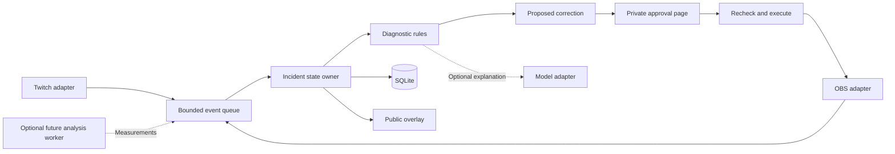

**For LiveCheck, Go and C# deserve serious consideration alongside TypeScript, Python, and Rust.** Your preference to explore beyond Node.js makes sense here: this is primarily a local background application, which gives other ecosystems a genuine opportunity to improve packaging, lifecycle management, or operating-system integration.

My provisional recommendations are:

- **Go:** best overall alternative for a compact, distributable background application.
- **C#/.NET:** best alternative if Windows integration and future audio-device diagnostics are important.
- **Rust:** strongest systems-programming direction, with more implementation effort.
- **Python:** strongest if audio analysis and local AI become central.
- **TypeScript:** still the quickest delivery option given your experience.
- **C++:** valuable for a future OBS plugin or specialized media component; less compelling for the current application core.

**No coding or installation has started.** This is a research-based comparison, checked against current documentation and repository material on **1 November 2026**. I have not benchmarked these implementations or validated the candidate libraries against your OBS installation.

---

**First, what LiveCheck actually needs from its stack**

The current product has three main inputs:

1. Twitch viewer reports.
2. OBS configuration and telemetry.
3. Broadcaster preferences and approvals.

It turns those into diagnoses, proposed corrections, and confirmation messages.

That workload is mostly **network communication, small state transitions, and configuration checks**. It is not initially a video-processing engine.

| Component | Actual work | What matters most |
|---|---|---|
| Twitch connection | OAuth, EventSub, reconnects, chat replies | Correct protocol handling and cancellation |
| OBS connection | Read settings, receive events, apply narrow changes | Compatible client library and accurate data mapping |
| Diagnostic engine | Compare observations with expected configuration | Clear rules, evidence, testability |
| Incident manager | Group reports, track progress, prevent duplicates | Predictable state ownership |
| Correction executor | Recheck, apply, verify, sometimes undo | Avoiding stale or repeated actions |
| Local controls | Setup, evidence, approval buttons | Simple browser integration |
| Public overlay | Show progress without exposing private information | Readability and low overhead |
| Persistence | Settings, incidents, action history | Reliable local storage |
| Optional AI | Interpret complaints and explain findings | Structured output, timeouts, bounded cost |
| Possible future audio analysis | Capture samples, detect clipping/silence/device changes | Media libraries and OS access |

The last row could change the language decision substantially. **Reading an OBS audio meter and analyzing actual audio samples are different capabilities.**

For the initial version, optimizing JSON processing from milliseconds to microseconds is unlikely to improve the user experience meaningfully. Avoiding an incorrect diagnosis or recovering cleanly after disconnects will matter much more.

---

**The wider language shortlist**

This is a broad survey of plausible choices—not a claim that every programming language would be equally sensible.

| Language | Best role in LiveCheck | Main advantage | Main disadvantage | My assessment |
|---|---|---|---|---|
| **Go** | Main background application | Straightforward concurrency and distribution | Less expressive domain modeling than Rust/F#; integration coverage needs checking | **Top candidate** |
| **C#** | Main application; Windows diagnostics | Strong async, application hosting, Windows ecosystem | Packaging and native-library choices need care | **Top candidate** |
| **Rust** | Main application; native components | Strong type modeling and memory safety in safe Rust | Ownership, async, and build complexity | **Strong conditional candidate** |
| **Python** | Main application; analysis worker | Rapid experimentation and extensive scientific tooling | End-user packaging and blocking-library pitfalls | **Strong conditional candidate** |
| **TypeScript** | Main application and browser interface | Familiarity and convenient Twitch/OBS integrations | Runtime packaging; CPU-heavy work needs separation | **Best delivery baseline** |
| **C++** | Native OBS plugin; media processing | Direct access to native media APIs | Build, memory, lifetime, and distribution complexity | **Specialist component** |
| **F#** | Diagnostic/state engine; potentially whole .NET app | Excellent modeling of explicit states and outcomes | Additional learning and fewer domain-specific examples | **Interesting alternative** |
| **Kotlin** | Main JVM application | Coroutines, expressive types, Java interoperability | JVM distribution and additional build tooling | **Viable, especially if familiar** |
| **Java** | Main JVM application | Mature networking and deployment ecosystem | More machinery than this small app needs | **Viable, lower priority** |
| **Elixir** | Supervised event-processing service | Strong process supervision and fault isolation | Less natural distribution for a small Windows utility | **Better for a future hosted service** |
| **Gleam** | Typed event/state processing on BEAM | Functional types with Erlang-runtime capabilities | More integration work and ecosystem learning | **Exploratory choice** |
| **Dart** | CLI/service; possible future Flutter client | Async programming and executable compilation | Less compelling without a Flutter roadmap | **Viable but not leading** |
| **Swift** | Especially a future macOS companion | Native Apple-platform integration | Weaker fit for your current Windows-first direction | **Platform-specific option** |
| **Lua** | Small script running inside OBS | Direct OBS scripting support | Poor fit for owning the complete application | **Small helper only** |
| **Zig** | Native helper or experimental core | Explicit memory management and C interoperability | More manual integration and toolchain work | **Not my first choice for this event** |
| **C** | Very small native OBS component | Direct C API compatibility | Manual resource management and application plumbing | **Specialist only** |
| **Ruby / PHP** | Technically capable service | Productive application programming | No clear advantage for this particular local utility | **Would not shortlist** |

Some relevant documentation supports these alternatives:

- Kotlin’s Ktor supports client and server WebSockets. [Ktor documentation](https://ktor.io/docs/client-websockets.html)
- Dart can produce self-contained executables. [Dart compilation](https://dart.dev/tools/dart-compile)
- Swift has a Windows toolchain; it is not restricted to Apple platforms. [Swift for Windows](https://www.swift.org/install/windows/)
- Gleam targets both the Erlang ecosystem and JavaScript. [Gleam](https://gleam.run/)
- OBS supports Python and Lua scripting, with important runtime and callback constraints. [OBS scripting](https://docs.obsproject.com/scripting)

The rankings above are my engineering judgment about **LiveCheck**, rather than general rankings of language quality.

---

**Go — my leading recommendation for a new-language implementation**

Go fits the application’s shape particularly well: several persistent connections, a small HTTP server, a bounded event-processing loop, and local storage.

**How I would structure it**

- One goroutine receives Twitch events.
- One receives OBS events.
- Both submit normalized observations to a bounded queue.
- One component owns the incident state and diagnostic transitions.
- Separate tasks handle slow network requests.
- An embedded HTTP server serves the controls and overlay.

This avoids allowing every callback to mutate shared state independently.

**Suggested Go stack**

| Component | Candidate |
|---|---|
| OBS | `andreykaipov/goobs` |
| Twitch EventSub | `joeyak/go-twitch-eventsub` |
| Twitch REST API | `nicklaw5/helix`, or a small adapter for the few required endpoints |
| HTTP server | Standard-library `net/http` |
| Browser assets | Standard-library `embed` |
| Logging | Standard-library `log/slog` |
| Storage | `database/sql` with a suitable SQLite driver |
| CLI | Standard `flag` initially; Cobra if the command structure grows |
| Testing | Standard `testing`, race detector, recorded event fixtures |
| AI | Ordinary HTTP client behind a small interface |

The repositories provide existing OBS and Twitch integration foundations. Their exact endpoint coverage still needs checking before adoption. [goobs](https://github.com/andreykaipov/goobs), [Go EventSub client](https://github.com/joeyak/go-twitch-eventsub), [Helix client](https://github.com/nicklaw5/helix)

**Why Go could improve on your usual stack**

The application and its browser assets can be distributed together. Users do not need Node.js or a separate frontend server. Go’s `embed` package supports including static files at build time. [Go embed documentation](https://pkg.go.dev/embed)

For SQLite, `modernc.org/sqlite` is a candidate that avoids CGo. That can simplify the build pipeline, though it has its own dependency and performance trade-offs. [Driver documentation](https://pkg.go.dev/modernc.org/sqlite)

**Trade-offs**

- Goroutines do not automatically make shared state safe.
- Cancellation and reconnect ownership still require deliberate design.
- External libraries may not cover every current Twitch endpoint.
- Native audio integration can introduce CGo or platform-specific code.
- “Single executable” still means a separate build for each supported OS/architecture.

CGo changes cross-compilation requirements; choosing a C-based dependency can make an otherwise simple Go distribution more complicated. [CGo documentation](https://pkg.go.dev/cmd/cgo)

**When I would choose Go:** you want a meaningful departure from TypeScript, a compact CLI/background product, and a manageable amount of new-language complexity.

---

**C#/.NET — the strongest alternative I would add to your original shortlist**

C# is particularly relevant because you are building on Windows and may eventually want to inspect audio devices, endpoint changes, or local system state.

It can also remain a console/background application. Choosing C# does not require building a large Windows GUI.

**Suggested C# stack**

| Component | Candidate |
|---|---|
| Application lifecycle | .NET Generic Host / `BackgroundService` |
| Event coordination | `System.Threading.Channels` |
| OBS | `obs-websocket-dotnet`, after validating the selected release |
| Twitch | TwitchLib EventSub/API components, or focused official-protocol adapters |
| Local HTTP interface | ASP.NET Core Minimal APIs |
| JSON | `System.Text.Json` |
| Storage | `Microsoft.Data.Sqlite` |
| CLI | Simple command handling; Spectre.Console if richer terminal output helps |
| Testing | xUnit or NUnit |
| Future Windows audio | Relevant NAudio packages |

.NET’s hosting abstractions provide configuration, logging, dependency management, and lifecycle support for long-running work. [Worker Services documentation](https://learn.microsoft.com/en-us/dotnet/core/extensions/workers)

**A concrete research finding**

The current `obs-websocket-dotnet` README documents a fix for `GetInputAudioTracks` previously returning false for every track. That is directly relevant to LiveCheck’s routing diagnosis.

This does not disqualify C#. It demonstrates why **testing the actual client behavior matters more than choosing a language from a feature chart**. [OBS .NET client](https://github.com/BarRaider/obs-websocket-dotnet)

TwitchLib also has an EventSub WebSocket component. Some README examples contain older guidance, so the official Twitch authentication documentation should remain authoritative. [TwitchLib component](https://github.com/TwitchLib/TwitchLib.EventSub.Websockets)

**Where C# becomes especially attractive**

If the roadmap includes:

- Detecting that the default microphone changed.
- Enumerating Windows audio endpoints.
- Observing device removal.
- Capturing a permitted local audio stream for analysis.

NAudio provides relevant Windows audio functionality, including WASAPI support. Its current repository also describes cross-platform components, so the platform restrictions should be assessed per package rather than treating all of NAudio as identical. [NAudio](https://github.com/naudio/NAudio)

**Packaging choices**

Start with a **self-contained deployment**. Consider single-file publishing if compatible with the selected dependencies.

Do not assume that “single-file” and “Native AOT” are the same thing. Native AOT adds constraints around reflection, dynamic code, trimming, and library compatibility. It is an optimization decision, not a requirement for a good application. [.NET publishing](https://learn.microsoft.com/en-us/dotnet/articles/core/deploying/), [Native AOT limitations](https://learn.microsoft.com/en-us/dotnet/core/deploying/native-aot/)

**When I would choose C#:** Windows is the primary platform, and you want a credible path toward deeper device diagnostics without immediately introducing another language.

---

**Rust — strong engineering fit, higher delivery effort**

Rust is a legitimate choice for the whole application. It is especially appealing if you want explicit state modeling, controlled resource use, and a substantial systems-programming learning experience.

**Suggested Rust stack**

| Component | Candidate |
|---|---|
| Async runtime | Tokio |
| OBS | `obws` |
| Twitch | `twitch_api` and `twitch_oauth2` |
| Local HTTP interface | Axum |
| HTTP requests | Reqwest |
| Data models | Serde |
| CLI | Clap |
| Logging | tracing |
| SQLite | rusqlite, or SQLx if its async integration is useful |
| Testing | Standard tests, property tests for state transitions where valuable |

The `obws` GitHub repository now points to another forge; its published API documentation remains available. I could inspect the docs, but the new forge was inaccessible through the browsing tool. [Published obws documentation](https://docs.rs/obws/latest/obws/), [repository redirect](https://github.com/dnaka91/obws)

The Twitch Rust ecosystem provides typed API and EventSub structures, with a separate OAuth library. That does not mean the application’s complete reconnect and lifecycle behavior comes for free. [twitch_api](https://github.com/twitch-rs/twitch_api)

**Where Rust helps LiveCheck**

You can represent incidents explicitly:

```text
Reported
Investigating
AwaitingApproval
Applying
AwaitingConfirmation
Resolved
Unresolved
```

Each state can carry only the data that belongs to it. This makes certain invalid combinations harder to express.

Safe Rust also prevents many memory-safety errors and data races. It does **not** prevent logical races such as applying a correction after the broadcaster manually changes the scene.

**Trade-offs**

- Async ownership can slow development when several tasks share state.
- Compile times and unfamiliar error messages can interrupt iteration.
- SQLite/native dependencies and target-specific builds still need attention.
- Rust does not automatically make a wrong diagnostic rule correct.
- Avoid blocking database or CPU work on an async executor thread.

**When I would choose Rust:** you already have some Rust familiarity, or learning it is a major project goal and you accept a narrower feature scope.

I would not select it merely because “background tool” sounds like a systems-language requirement.

---

**Python — strongest when analysis becomes the product’s center**

Python is entirely adequate for the initial event-and-configuration workload.

Its strongest advantage appears if LiveCheck evolves toward audio analysis, computer vision, or local inference.

**Suggested Python stack**

| Component | Candidate |
|---|---|
| Main runtime | `asyncio` |
| Twitch | TwitchIO |
| OBS | `simpleobsws` |
| Models and validation | Pydantic |
| Local HTTP interface | FastAPI/Starlette or aiohttp |
| Storage | Standard SQLite interface, with blocking operations isolated appropriately |
| CLI | Typer |
| Testing | pytest |
| Future analysis | NumPy/SciPy and task-specific audio libraries |
| Distribution | PyInstaller, or a managed Python environment for the development audience |

TwitchIO currently documents async API/EventSub support and token-management capabilities. `simpleobsws` provides an asynchronous OBS connection. [TwitchIO](https://github.com/TwitchIO/TwitchIO), [simpleobsws](https://github.com/IRLToolkit/simpleobsws)

An alternative is `obsws-python`, but it should not be treated as a drop-in async client. Blocking calls need isolation if the rest of the application uses an event loop. [obsws-python](https://github.com/aatikturk/obsws-python)

**Where Python wins**

- Rapid experiments with signal thresholds.
- Analysis of captured test audio.
- Evaluation datasets and diagnostic experiments.
- Local model integration.
- Short iteration cycles when requirements are uncertain.

**Trade-offs**

- Packaging needs testing on clean machines.
- Native scientific dependencies can make distributions larger and more fragile.
- CPU-heavy Python code can delay other work unless moved out of the event loop.
- A packaged Python executable still includes runtime/dependency machinery.

PyInstaller is not a general cross-compiler: its output depends on the build operating system and Python environment. [PyInstaller documentation](https://pyinstaller.org/en/stable/operating-mode.html)

**When I would choose Python:** audio intelligence is an actual near-term feature, rather than a hypothetical future possibility.

For three OBS configuration checks, Python’s scientific ecosystem would not yet provide much advantage.

---

**TypeScript — a useful baseline, without making it the automatic winner**

Your familiarity remains a real advantage. We should acknowledge it without allowing it to decide every project.

**Suggested stack**

- TypeScript.
- Node.js.
- Twurple.
- obs-websocket-js.
- Zod.
- SQLite.
- A small HTTP server.
- Plain browser HTML/CSS/JavaScript.
- Your preferred test runner.

The main benefits are integration convenience, fast iteration, and shared types between the application and browser interface.

The limitations are mostly deployment and keeping blocking/CPU-heavy work away from the event loop.

**Node.js, Bun, and Deno are runtime alternatives—not different programming languages.**

| Runtime | Why consider it | What needs checking |
|---|---|---|
| **Node.js** | Familiar package behavior and existing integrations | Packaging and native dependencies |
| **Bun** | Convenient executable bundling | Compatibility of the actual dependency set |
| **Deno** | Executable compilation and explicit permissions | npm compatibility, permission configuration, native dependencies |

All three have executable-distribution options. It would therefore be inaccurate to say that leaving TypeScript is the only way to distribute an application without a separately installed runtime. [Node SEA](https://nodejs.org/api/single-executable-applications.html), [Bun executable builds](https://bun.sh/docs/bundler/executables), [Deno compile](https://docs.deno.com/runtime/reference/cli/compile/)

**When I would choose TypeScript:** completing the event submission quickly is substantially more important than exploring a different language.

Changing from Node to Bun may improve the workflow, but it would not satisfy your desire to experience a substantially different programming model.

---

**C++ — use it where native access gives a concrete benefit**

C++ becomes attractive if we need to work **inside OBS’s media pipeline**.

For the current application, it would mostly replace convenient HTTP, JSON, state, and UI plumbing with more demanding implementation work.

**Possible C++ stack**

- C++ with CMake.
- Boost.Asio/Beast for networking.
- A JSON library.
- SQLite.
- A small embedded HTTP interface.
- OBS’s plugin API if implementing a native module.

Boost.Beast supplies HTTP/WebSocket foundations, while OBS’s plugin APIs expose sources, filters, outputs, and other native functionality. [Boost.Beast](https://www.boost.org/doc/libs/latest/libs/beast/doc/html/index.html), [OBS plugins](https://docs.obsproject.com/plugins)

**Where C++ could help later**

A small OBS module might inspect an explicitly selected audio source and emit measurements to the external application.

That is materially different from controlling OBS over WebSocket.

**Trade-offs**

- Native plugins increase installation and compatibility work.
- Code running inside OBS can affect the broadcaster’s main application if it crashes or blocks.
- Audio callbacks should avoid network requests, database writes, blocking locks, and unpredictable work.
- Manual lifetime and resource handling creates additional failure possibilities.

**When I would choose C++:** a required capability cannot be implemented adequately through OBS’s external interfaces.

For the current MVP, I would keep the application outside OBS.

---

**Other alternatives worth understanding**

**F# is the most interesting additional option for the diagnostic engine.** Its discriminated unions fit explicit incident states and outcomes well. It can use the broader .NET ecosystem. A C# host with an F# rules library is also possible without introducing a second operating-system process. [F# discriminated unions](https://learn.microsoft.com/en-us/dotnet/fsharp/language-reference/discriminated-unions)

However, for three diagnostic rules, C# or Rust can already provide sufficiently clear modeling. F# would be a deliberate functional-programming choice rather than a necessity.

**Kotlin and Java are credible complete implementations.** Kotlin’s coroutines and Ktor fit network-oriented work. Java’s `jpackage` can create self-contained application bundles, so users need not necessarily install a JDK themselves. [Java packaging](https://docs.oracle.com/en/java/javase/25/jpackage/packaging-overview.html)

I would prioritize them if you already know the JVM ecosystem or expect integration with a larger JVM product.

**Elixir and Gleam are interesting for supervision and concurrent services.** They become more compelling if a future hosted system coordinates many channels. For a small local Windows application, their runtime distribution and specialized integration work are less attractive. Elixir releases can include the runtime, but still have target-platform requirements. [Elixir releases](https://hexdocs.pm/mix/Mix.Tasks.Release.html)

**Dart makes more sense if a Flutter client becomes important.** There is no need to build a Flutter application merely to justify Dart.

**Swift makes more sense for a macOS-focused product.** Its Windows support is real, but that alone does not give it a stronger OBS/Twitch ecosystem for this project.

**Lua is appropriate for a tiny OBS-specific helper.** It should not own the Twitch connection, database, diagnostic lifecycle, and browser controls.

**Zig is an interesting systems-learning choice**, particularly around explicit memory and C interoperability. I do not see a current LiveCheck requirement that makes its additional integration work worthwhile. [Zig overview](https://ziglang.org/learn/overview/)

---

**Comparison by core component**

The table below is my qualitative assessment. “Strong” does not mean measured faster.

| Component | TypeScript | Python | Go | C# | Rust | C++ |
|---|---|---|---|---|---|---|
| Twitch/OBS integration convenience | Strong | Strong | Good | Good | Good | More manual work |
| Explicit diagnostic state modeling | Strong with validation | Good with typed models | Good | Strong | Very strong | Strong but more work |
| Background lifecycle management | Good | Good | Strong | Strong | Strong | Strong but manual |
| Straightforward distribution | Requires packaging choices | Requires packaging work | Strong | Strong, deployment-mode dependent | Strong, dependency dependent | Native dependency management |
| Windows device integration | Usually extra bindings/helper | Available, uneven | More platform-specific work | **Particularly strong** | Native bindings available | **Particularly strong** |
| Audio/ML experimentation | Usually external tools | **Particularly strong** | Limited direct ecosystem | Good for some workloads | Good native/inference options | Strong low-level tooling |
| Native OBS plugin work | Poor direct fit | Scripting only | Awkward fit | Usually indirect | Possible through bindings/FFI | **Natural fit** |
| Learning effort from your TS background | Lowest | Relatively approachable | Moderate | Moderate | Higher | Higher |

I would not assign invented memory or latency numbers. Resource usage depends heavily on implementation, logging, polling frequency, loaded libraries, and whether a local model is running.

---

**Where a mixed stack actually helps**

There are three distinct types of “mixed stack,” with very different costs.

**1. A native/service backend plus a browser interface — recommended**

Examples:

- Go + HTML/CSS/JavaScript.
- C# + HTML/CSS/JavaScript.
- Rust + HTML/CSS/JavaScript.

This is a natural split. The browser needs web-compatible assets, but those assets can be embedded and served by the main executable.

**You do not need a Node.js backend just because the overlay uses JavaScript.**

A frontend build tool could be a development dependency without becoming part of the installed runtime.

**2. A core application plus a specialist worker — useful only when justified**

| Combination | When it helps | Cost |
|---|---|---|
| **Go + Python** | Go owns lifecycle/integrations; Python runs substantial audio or local-model analysis | Two runtime distributions and a worker protocol |
| **C# + Python** | Windows diagnostics plus Python-specific ML functionality | More packaging; ensure the worker adds something C# cannot conveniently do |
| **Rust + Python** | Rust owns the dependable core; Python supports evolving research code | Async/IPC coordination and two ecosystems |
| **Go/C#/Rust + C++ OBS module** | Native OBS measurements unavailable through existing interfaces | Plugin installation, version compatibility, crash exposure |
| **C# + F# library** | Complex domain rules benefit from functional modeling | Two languages, but one .NET process/runtime |

For a specialist worker, a practical starting boundary is versioned JSON messages over standard input/output. The core launches the worker, applies timeouts, and handles failure.

For high-volume raw audio, JSON is inappropriate. A later implementation would use binary framing or another suitable transport.

**3. Multiple languages performing the same application work — usually unhelpful**

I would avoid a design such as:

> TypeScript for Twitch, Go for OBS, Rust for rules, Python for explanations.

That creates four places to manage packaging, errors, shutdown, logs, and compatibility without a strong reason.

Also, **calling an AI API does not justify adding Python**. Every leading language can make an HTTP request and validate the response.

---

**The architecture I would preserve regardless of language**



The important design choices are:

- One clear owner of incident state.
- Diagnostic rules separated from network callbacks.
- An action executor that rechecks current state.
- Bounded queues so stale telemetry cannot accumulate indefinitely.
- Separate public and private interfaces.
- AI outputs treated as interpretations, not direct authority to change settings.

High-frequency meter observations can be aggregated in memory. We do not need to write every volume event to SQLite.

Also, I would initially run the program **in the broadcaster’s user session**, possibly with a hidden window or tray launcher later. A background application is not automatically a Windows Service. Windows Services have session and interaction restrictions that complicate desktop/audio workflows. [Microsoft service guidance](https://learn.microsoft.com/en-us/windows/win32/services/interactive-services)

---

**Complete stack options I would put in front of you**

| Stack | Core and integrations | Interface/storage | Best reason to choose |
|---|---|---|---|
| **A — Go compact application** | Go, goobs, EventSub adapter, Helix/HTTP | Embedded browser assets, SQLite | **Best balance of a new language and manageable architecture** |
| **B — C# Windows-oriented application** | .NET host, OBS client, TwitchLib/focused adapters | Minimal APIs, browser assets, SQLite | **Best path toward Windows device diagnostics** |
| **C — Rust systems application** | Tokio, obws, twitch_api, Serde | Axum, embedded assets, SQLite | **Best deliberate systems-programming investment** |
| **D — Python analysis-oriented application** | asyncio, TwitchIO, simpleobsws, Pydantic | Small web server, SQLite | **Best if audio/ML analysis is genuinely imminent** |
| **E — TypeScript delivery baseline** | Node.js, Twurple, obs-websocket-js, Zod | Small web server, SQLite | **Fastest likely delivery with your existing experience** |
| **F — Go plus Python worker** | Stack A plus isolated analysis worker | Same Go-served interface and database | Choose only after a concrete Python-only analysis need appears |

For all six, I would initially keep:

- **Configuration:** a small JSON or TOML file.
- **Secrets:** separate from public configuration and logs; OS credential storage where practical.
- **Database:** SQLite with a small schema.
- **Local API:** authenticated private controls and read-only public state.
- **AI:** optional provider adapter with timeout and structured response validation.
- **Logging:** structured, redacted, and bounded.
- **Distribution:** one explicitly supported Windows build first.
- **UI:** a compact browser page and OBS overlay; no desktop framework required.

Electron, Tauri, WPF, Avalonia, Flutter, and similar application shells can be considered later if a tray experience, installer, or native window materially improves the product. They are not needed for the diagnostic workflow.

---

**What would decide between Go, C#, and Rust**

I would use these questions as decision criteria rather than choosing by popularity:

| Priority | Strongest direction |
|---|---|
| Learn a new language while keeping the build approachable | **Go** |
| Make Windows audio/device integration part of the product | **C#** |
| Learn ownership, typed state modeling, and native systems design | **Rust** |
| Experiment extensively with audio algorithms/local models | **Python** |
| Minimize delivery risk with the remaining hackathon time | **TypeScript**, or a language you already know well |
| Add capabilities inside OBS’s media pipeline | **Small C/C++ plugin**, with an external core |

Before declaring a final dependency set, the selected stack should eventually prove five things:

1. Read the correct OBS microphone track assignments.
2. Receive actual Twitch chat events.
3. Recover correctly from disconnects.
4. Apply and read back one approved change.
5. Run from its packaged distribution on a clean environment.

Those would be targeted compatibility checks **after you authorize the next implementation stage**, not work I am starting now.

---

**Name suggestions**

I would use a distinctive product name and a clear subtitle such as:

> **Community-assisted stream diagnostics for Twitch**

That communicates the platform without forcing “Twitch” into the name itself.

These are naming candidates, not confirmed domain, package-name, or trademark availability.

| Name | What it communicates | My take |
|---|---|---|
| **CueMender** | Keeps the production running and helps repair problems | **Best overall balance of distinctive and relevant** |
| **CastTriage** | Investigates broadcast problems before proposing action | **Best technical/product description** |
| **ChatLifeline** | The community helps rescue a troubled stream | **Best emphasis on viewer participation** |
| **CueRescue** | Fast assistance during a live production | Friendly and easy to understand |
| **RaidReady** | A stream prepared for an incoming audience | Strong Twitch association, but suggests preflight checks more than live diagnosis |
| **LurkAlert** | A quiet watcher that speaks up when needed | Twitch-flavored and playful |
| **MicMender** | Repairs microphone-related problems | Memorable, but too narrow if visual diagnostics remain important |
| **StreamFirstAid** | Immediate help for stream problems | Clear, although longer and less distinctive |
| **ChatPitCrew** | Viewers and the tool act as a support crew | Good community metaphor; more playful |
| **CueMedic** | Production assistance and diagnosis | Short and understandable |
| **OnAirAlly** | A companion during broadcasts | Friendly, but less technically specific |
| **SceneSentry** | Watches scene state and configuration | Appropriate if visual checks become central |

I excluded **SignalCrew** after finding an existing Twitch hackathon project using that exact name. [Existing project](https://devpost.com/software/signalcrew)

My preferred combinations are:

- **CueMender — Keep the show going.**
- **CastTriage — From chat report to verified fix.**
- **ChatLifeline — Your community helps keep you live.**

**My provisional choice is CueMender with a Go core, embedded browser controls, and SQLite.** C# is a very close alternative if Windows device diagnostics are part of your intended direction. Rust remains a strong choice if the learning experience is important enough to justify keeping the feature scope especially tight.

I would keep Python as a possible future analysis worker, rather than committing to a mixed backend before we have a feature that benefits from it.