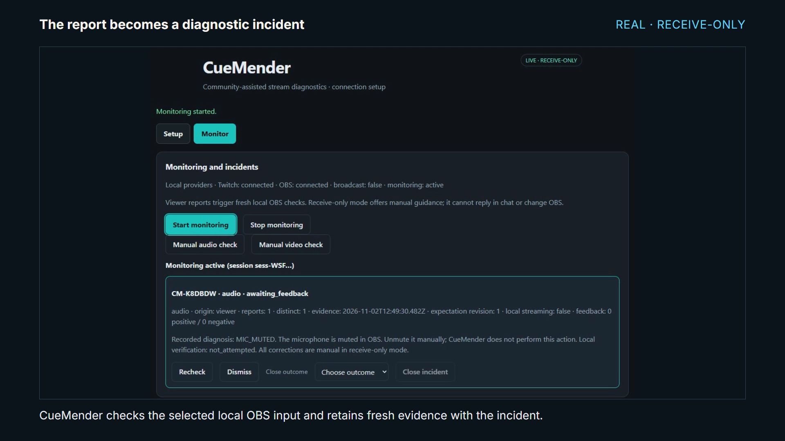
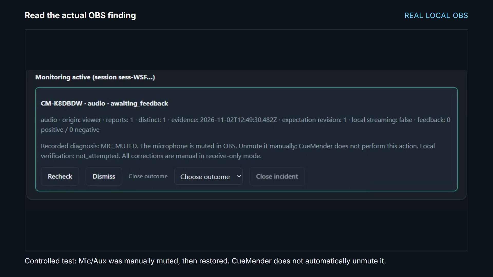
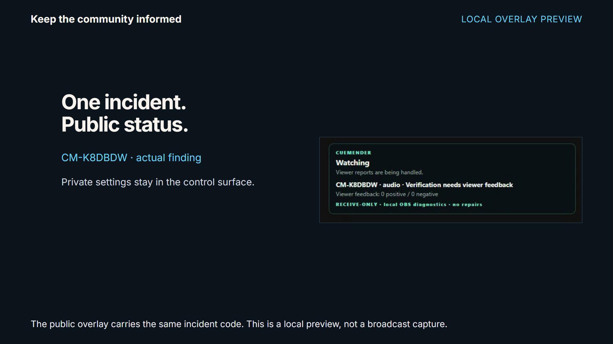
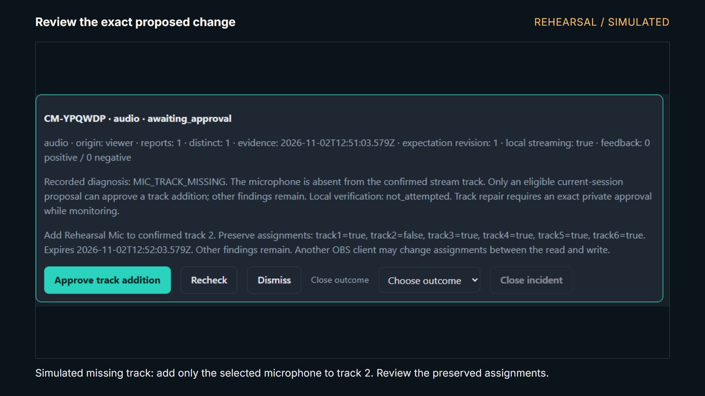
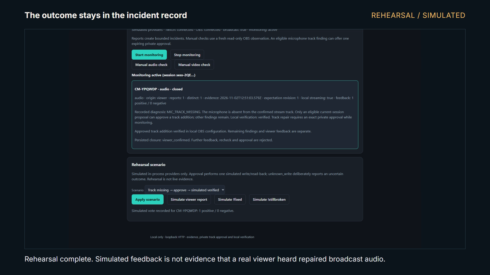

<h1 align="center">CueMender</h1>

<p align="center">
  <strong>Hear the report. Check the evidence. Keep control.</strong><br />
  Twitch viewer reports, local OBS diagnostics, and reviewable incidents in one small Windows application.
</p>

<p align="center">
  Built for the <a href="https://twitchcon-codex.devpost.com/">Codex x TwitchCon Hackathon 2026</a><br />
  By Desan Vasu
</p>

<p align="center">
  
  
  
  <a href="LICENSE"></a>
</p>

<p align="center">
  <a href="#features">Features</a> ·
  <a href="#demo">Demo</a> ·
  <a href="https://youtu.be/4mv0Kk3gm-w">Watch video</a> ·
  <a href="https://github.com/desanv01/cuemender/releases/tag/v1.0.0">Download</a> ·
  <a href="#get-started">Get started</a> ·
  <a href="#built-with-codex">Built with Codex</a> ·
  <a href="docs/submission/release/TESTING.md">Testing guide</a>
</p>

<p align="center">
  
  <br /><sub>Actual frame from the working demo · real Twitch chat and local OBS · offline channel, receive-only mode.</sub>
</p>

## Why CueMender

A streamer hears “no sound” from chat while already presenting. That report matters, but it does not explain whether OBS has a muted microphone, a missing track assignment, or a different problem.

CueMender keeps the report beside fresh configuration evidence. Inspect the finding, preserve uncertainty, follow manual guidance or review the narrowly supported approval workflow, and record the outcome. A local configuration check and a viewer saying the broadcast sounds fixed remain separate pieces of evidence.

## Features

<table>
<tr>
<td width="50%" valign="top">

### Receive community reports

A separate viewer sends `!issueaudio` or `!issuevideo`. Bounded command intake, deduplication and session ownership keep reports tied to the intended monitoring session. Receive-only chat works without a developer app and sends no replies.

</td>
<td width="50%" valign="top">

### Check fresh OBS evidence

Inspect three conditions: the selected microphone is muted, it is absent from the confirmed stream track, or a configured direct scene item is hidden. Stale, disconnected, partial or mismatched evidence stays unknown.

</td>
</tr>
<tr>
<td width="50%" valign="top">

### Review one exact correction

The authenticated implementation proposes only adding the selected microphone to the confirmed track. Private approval expires, fresh checks precede dispatch, and uncertain outcomes are reconciled without blindly replaying a write. The real approved-repair trial remains pending; rehearsal demonstrates the workflow.

</td>
<td width="50%" valign="top">

### Separate private and public views

Private controls show settings, evidence and approval details. The public overlay exposes incident status without private source names or credentials. Loopback sessions and CSRF checks protect local control routes.

</td>
</tr>
<tr>
<td width="50%" valign="top">

### Retain feedback and outcomes

Group repeated reports into durable incidents. Keep viewer feedback separate from local verification, recheck eligible incidents, and explicitly close a supported outcome. Settings or provider changes invalidate old work.

</td>
<td width="50%" valign="top">

### Rehearse without accounts

Run isolated, clearly labeled simulated providers. Exercise a missing track, muted microphone, wrong scene or unknown write outcome without Twitch credentials, OBS, Go or Node. Rehearsal cannot contact real providers.

</td>
</tr>
</table>

## Demo

The verified **2:45 silent demo** shows a real separate-account Twitch command producing an actual local OBS `MIC_MUTED` finding, followed by a separately labeled simulated repair and genuine Codex build footage. [Watch the demo →](https://youtu.be/4mv0Kk3gm-w) · [Video verification →](video-production/cuemender-demo/DELIVERY-RECEIPT.md)

1. Receive a real viewer report through the receive-only connection.
2. Inspect the fresh microphone finding and matching public incident code.
3. Recognize the boundary: no chat replies, OAuth ownership proof or real repairs in receive-only mode.
4. Switch to the separate rehearsal demonstration: review the exact track proposal, approve a simulated write, and inspect its read-back.
5. Record simulated viewer feedback and closure, then see genuine Codex implementation footage.

<table>
<tr>
<td width="50%" valign="top">
  <a href="docs/assets/demo/evidence.png"></a>
  <p><strong>Actual local evidence.</strong> The user-approved temporary microphone mute was restored after capture. OBS was not broadcasting.</p>
</td>
<td width="50%" valign="top">
  <a href="docs/assets/demo/overlay.png"></a>
  <p><strong>Public status, private details.</strong> The same incident appears in the local overlay preview; this is not a broadcast recording.</p>
</td>
</tr>
<tr>
<td width="50%" valign="top">
  <a href="docs/assets/demo/proposal.png"></a>
  <p><strong>One reviewed change.</strong> The isolated rehearsal adds only the selected track and preserves the others. No real OBS write is shown.</p>
</td>
<td width="50%" valign="top">
  <a href="docs/assets/demo/closure.png"></a>
  <p><strong>A retained outcome.</strong> Simulated feedback and closure remain explicitly separate from actual broadcast audio recovery.</p>
</td>
</tr>
</table>

All screenshots are decoded frames from the verified application demo, with its real/rehearsal labels intact. [Frame provenance and attribution →](docs/assets/demo/README.md)

## Get started

### Run the Windows preview

Download the [Windows x64 ZIP](https://github.com/desanv01/cuemender/releases/download/v1.0.0/cuemender-windows-x64-1.0.0.zip) and [SHA-256 checksums](https://github.com/desanv01/cuemender/releases/download/v1.0.0/SHA256SUMS.txt) from [v1.0.0](https://github.com/desanv01/cuemender/releases/tag/v1.0.0). Extract into a user-writable folder. The executable includes its browser assets; **Go and Node are not needed**.

```powershell
Expand-Archive .\cuemender-windows-x64-1.0.0.zip -DestinationPath .\CueMender
Set-Location .\CueMender
.\cuemender.exe --mode rehearsal --no-browser
```

Open the one-time private control link printed in the console. Choose the track-missing rehearsal scenario, start monitoring, simulate a report, review the proposal, approve the simulated change, then record feedback and closure. Every rehearsal surface is labeled; no real Twitch or OBS connection is made.

The ZIP is unsigned and was verified after fresh extraction on the development machine, including a path with spaces. It is not claimed to have passed a separate clean-machine test.

### Connect real receive-only Twitch chat

Stop rehearsal with **Ctrl+C**, then run:

```powershell
.\cuemender.exe --receive-only-channel YOUR_TWITCH_LOGIN --no-browser
```

In private **Setup**, confirm the selected channel is intended to report on your local OBS. Connect chat and OBS WebSocket, select the microphone, confirm the stream track, and start monitoring. A separate viewer can send `!issueaudio` in that channel, including while it is offline if chat access is allowed.

Receive-only mode sends **no chat replies** and cannot prove channel ownership or authorize OBS changes. All corrections remain manual. Real chat-to-local-diagnostic evidence does not prove what an audience hears.

### Data and shutdown

Use **Ctrl+C** to stop CueMender. A single process owns each effective data directory; a second process cannot share it even on another port. The default listener is `http://127.0.0.1:8787/`; the public overlay is `/overlay/`.

For storage compatibility, data remains under `%AppData%\LiveCheck`, with separate `rehearsal` and `receive-only\YOUR_TWITCH_LOGIN` children. `--data-dir` selects a different base. Do not copy authenticated databases into receive-only or rehearsal directories. A restarted process prints a new private launch link; OBS Connect after restart is explicit.

[Detailed setup and judging walkthrough →](docs/submission/release/TESTING.md) · [Build from source and developer checks →](docs/DEVELOPMENT.md)

## Built with Codex

**OpenAI Codex** shaped the architecture and contracts, reviewed implementation packets, and substantively implemented the private approval/repair engine, receive-only integration, integration fixes and debugging. Genuine main-chat build footage appears in the demo.

**DeepSeek** implemented P01–P03, P05 and P06 worker packets and corrections. Codex completed P04 and remaining integration/release work, using user-requested GPT-6.1 Sol high agents for bounded work and review. Verification of Codex-authored code is recorded as self-verification, with separate peer inspection where performed.

The application itself needs no runtime AI service, paid-model account or cloud database. [Contribution record →](docs/execution/CONTRIBUTIONS.md) · [Release review →](docs/execution/handoffs/P06-review.md)

## Built with

| Runtime | Interface | Persistence | Integrations |
| --- | --- | --- | --- |
| Go 1.27.3 · Windows x64 · CGo-free build | Embedded HTML/CSS/vanilla JavaScript · HTTP/SSE | SQLite via modernc · OS keyring or explicit memory-only secrets | Receive-only Twitch IRC · authenticated EventSub/Helix · OBS WebSocket |

One local process owns settings, sessions and incident state. Provider generations, settings revisions, durable intent and bounded queues prevent stale work from becoming current evidence.

## Current scope

- **Included:** three configuration diagnoses, real receive-only chat intake, durable incidents/feedback, private controls, redacted overlay, isolated rehearsal and a packaged Windows preview.
- **Implemented, real verification pending:** authenticated Twitch EventSub and the private approved track-addition workflow. See [#6](https://github.com/desanv01/cuemender/issues/6) and [#10](https://github.com/desanv01/cuemender/issues/10).
- **Demonstrated:** real offline-channel chat → local OBS diagnosis; separately simulated repair/feedback/closure. No broadcast recovery or real approved repair claim.
- **Outside this build:** automatic unmute/source reveal, stream start/stop, raw audio analysis, computer vision, OS-device repair, multiple channels and autonomous repair.
- **Limits:** OBS has no atomic compare-and-set against other clients; local read-back is not proof of viewer audio. The release is unsigned, tested by fresh extraction on the development machine, and not validated on a separate clean VM.

[Known limitations and attribution →](docs/submission/release/KNOWN_LIMITATIONS.md)

## Documentation

- [Setup and testing](docs/submission/release/TESTING.md)
- [Known limitations and attribution](docs/submission/release/KNOWN_LIMITATIONS.md)
- [Release review](docs/execution/handoffs/P06-review.md)
- [Verified video and publication state](docs/submission/release/VIDEO_DELIVERY.md)
- [Submission description and contribution evidence](docs/submission/release/SUBMISSION_COPY.md)
- [Architecture and shared behavior](docs/execution/ARCHITECTURE.md)

## Feedback

Found a problem or have a useful streamer workflow in mind? [Open an issue](https://github.com/desanv01/cuemender/issues) with the expected result and reproducible steps. Use fictional or permission-cleared examples; keep credentials, private launch links and raw chat logs out of public reports.

## License

Original CueMender code is [MIT licensed](LICENSE). Dependencies, fonts, third-party interfaces and trademarks retain their own rights and licenses. Distribution notices and patched-goobs attribution are preserved in [release/](release/THIRD_PARTY_NOTICES.md) and the Windows ZIP; video asset terms are recorded [separately](video-production/cuemender-demo/ASSET-NOTICES.md).
